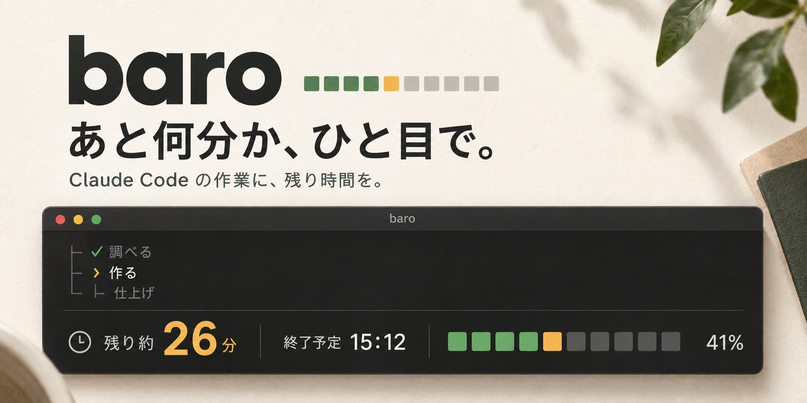

# baro



Claude Code に仕事を頼んだとき、**あと何分待てばよいか**を画面の下に出す道具です。

```
████▓░░░░░ 3/7 ｜ 今: 2.2 設計書を書く（経過7分・残り約4分） ｜ 残り全体 約26分（15:12）
```

Claude が作業の最初に「段階 › 手順」の木と手順ごとの見込み時間を宣言し、手順を終えるたびに進めます。
baro はそれを集計し、残り時間・終了予定時刻・進み具合のバーをステータスラインと返信に出します。
Claude Desktop の Code タブでは、入力欄の上の帯に同じ 1 行を出します。

*baro shows "how many minutes until Claude Code is done" in the status line (or above the prompt in the Claude Desktop Code tab). Japanese UI only for now.*

## 画面

| 状態 | 表示 |
|---|---|
| 作業中 | `████▓░░░░░ 3/7 ｜ 今: 2.2 設計書を書く（経過7分・残り約4分） ｜ 残り全体 約26分（15:12）` |
| 見込み超過 | `████▓░░░░░ 3/7 ｜ 今: 2.2 設計書を書く（経過13分・見込み10分を超過） ｜ 残り全体 約25分（15:14）` |
| 回答待ち | `████▓░░░░░ 3/7 ｜ 🙋 回答待ち: 公開してよいですか？ ｜ 再開後 残り約26分` |
| 指示待ち | `████▓░░░░░ 3/7 ｜ 💤 次の指示待ち ｜ 再開後 残り約26分` |
| 完了 | `██████████ 7/7 ｜ ✅ 完了 47分（見込み 43分）` |

`baro` と打つと詳しい表示:

```
📋 採用ページ 5 社の画像差し替え
   ⏳ 残り約 26分（終了予定 15:12） ・ 🕒 18分 / 全体 44分
   ████▓░░░░░ 41% ・ 手順 3/7
│                                     経過/見込み
├─ 1 調べる                            6/ 5分 █████
│   ├─ 🟩 1.1 公開中のページを確認     2/ 2分
│   └─ 🟩 1.2 画像の候補を集める       4/ 3分 🔺+1分
├─ 2 作る                             12/28分 ██▓░░
│   ├─ 🟩 2.1 差し替える画像を決める   5/ 5分
│   ├─ 🟨 2.2 設計書を書く             7/10分 ◀ 作業中
│   └─ ⬜ 2.3 組み立てる               -/13分
└─ 3 仕上げ                            -/10分 ░░░░░
    ├─ ⬜ 3.1 スマホ幅で確かめる       -/ 5分
    └─ ⬜ 3.2 公開する                 -/ 5分
```

バーは █ が済み、▓ が今の手順、░ が未着手です。手順の印は 🟩 完了・🟨 作業中・⬜ 未着手・🟦 回答待ち・🟥 停止中・⬛ 中止。

## 必要なもの

- Claude Code（CLI）、または Claude Desktop の Code タブ
- Python 3.9 以上（外部ライブラリは使いません）
- macOS / Linux

## インストール

Claude Code に次の文を貼ると、Claude がインストールと設定を行います。

```
baro（https://github.com/akkijp/baro）を入れて、Claude Code につないでください。
1. `uv tool install git+https://github.com/akkijp/baro` を実行する。uv が無ければ `pipx install git+https://github.com/akkijp/baro`、どちらも無ければ `python3 -m pip install --user git+https://github.com/akkijp/baro`。
2. `which baro` で入った場所を確認する。PATH に無ければ、以後はフルパスで呼ぶ。
3. `baro setup --apply` を実行する（~/.claude/settings.json を書き換え、/baro-calibration スキルを ~/.claude/skills/ に入れる。settings.json のバックアップは自動で取られる）。
4. `baro rules --install` を実行する（~/.claude/CLAUDE.md にルールを追記する）。
5. `baro doctor` を実行し、NG があれば直す。
6. Claude Desktop の Code タブでも使うなら、`git clone https://github.com/akkijp/baro ~/.local/share/baro-src` を実行し、~/.claude/settings.json の `env` に `"CLAUDE_CODE_PLUGIN_DIRS": "<ホームの絶対パス>/.local/share/baro-src/mod/baro-band"` を足す（既に値があれば `:` で区切って後ろに足す）。
7. 最後に、Claude Code（Desktop なら Claude Desktop）を起動し直すよう伝える。
```

終わったら Claude Code を起動し直してください。次に 3 手順以上の依頼をすると、画面の下に残り時間が出ます。

手で入れる方法・`baro setup --apply` が書き換えるもの・Claude Desktop の設定・アンインストールは [docs/install.md](docs/install.md)。

## 使い方

ふだんは何もしなくてかまいません。3 手順以上になりそうな依頼をすると、Claude が計画を立て、画面の下に残り時間が出ます。

- `baro` — 今のセッションの詳しい表示
- `baro ls` — 進行中の計画があるセッションの一覧
- `baro stats` — 見込みの当たり具合

見込みは過去の実績で自動で補正されます。データはすべて `~/.claude/baro/` の下に置き、外部には何も送りません。

## ドキュメント

- [インストールの詳細・アンインストール](docs/install.md)
- [コマンドとデータ](docs/commands.md) — Claude が呼ぶコマンド、Claude へのルール、保存ファイル
- [残り時間と見込みの補正](docs/calibration.md)
- [開発](docs/development.md)
- [設計書](docs/DESIGN.md)

## ライセンス

MIT
